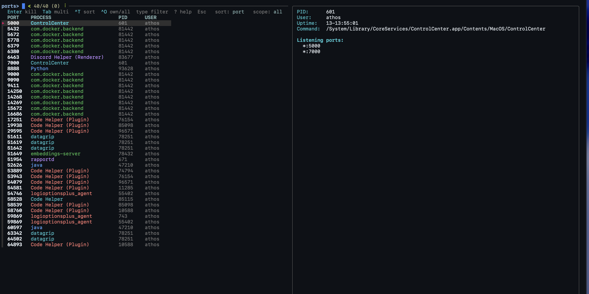

# terminal-tools


Small terminal tools for macOS and Linux. Three are keyboard-driven TUIs built
on [fzf](https://github.com/junegunn/fzf): a Kubernetes cockpit (`kube`), a log
follower (`logs`), and a TCP-port process killer (`ports`). Two are plain
commands with a menu bar app: `monitor` turns the external display off without
unplugging it (USB-C keeps charging), on macOS and on Linux with Hyprland, and
`vox` is a [Voxtype](https://github.com/peteonrails/voxtype) companion that
shows the daemon state and keeps the last transcriptions so you can copy one
again.

Every tool is generic: nothing in this repo is tied to one machine or one
person. A value that differs per machine (a monitor's HDMI input number, a
path) lives in a config file under `~/.config/terminal-tools/`, outside the
repo.

| Tool | What it does |
|------|--------------|
| **`kube`** | A Kubernetes cockpit: problems on top, then every workload / pod / node / ingress / secret / IP, with live metrics, contextual actions (restart, scale, exec, port-forward, logs…) and auto-refresh. A lightweight, keyboard-first take on `k9s`. |
| **`logs`** | Follow logs of any workload — Deployments, StatefulSets, DaemonSets and standalone Jobs — across all namespaces — one color per pod, auto-reconnect on restarts. |
| **`ports`** | View and kill processes listening on TCP ports, with a confirm step. |
| **`monitor`** | No TUI: turn the external display off/on without unplugging it — a USB-C monitor keeps charging the Mac while showing nothing. Also ships **MonitorBar**, a one-click menu bar toggle (no Dock icon, starts at login). On Linux (Hyprland), `monitor-linux` does the same and adds a 15-second pause, with an Omarchy bar widget. |
| **`vox`** | No TUI: keeps the last 15 [Voxtype](https://github.com/peteonrails/voxtype) dictations (Voxtype keeps none) through its post-process hook, and lists or copies them in the terminal. Ships **VoxBar** (macOS), one menu bar item for Voxtype: the daemon state as the icon, restart and log, and the recent dictations with copy on click. |
| **`gh-shim`** | No TUI: a wrapper installed as `gh`. With several GitHub accounts logged in to `gh`, it runs each command as the account that git uses for the current repository, instead of the one active account. |

Every mutating action **prints the real command it runs** (`$ kubectl rollout
restart …`, `$ kill -TERM …`) before executing — so the TUI doubles as a way to
learn the commands underneath.

## Demo

**`ports`** — find and kill whatever is holding a TCP port; contextual header,
one color per process, and live details in the preview pane:



**`kube`** — problems surface on top, the header shows the keys that apply to the
current tab, and columns stay labeled and aligned:

```text
overview │ pods │ nodes │ events │ ingress │ config │ ips     ns: all   sort: name   live: 5s
Enter logs  ^R restart  ^S scale  ^D describe  ^Y yaml  ^X delete  ^P pods  ^A more  │  ^N ns  ^T sort  ^L live  Tab view  ? help  Esc
NAMESPACE           NAME                        KIND    READY   IMAGE                 CPU      MEM
● platform          api-gateway                 deploy  1/2     api-gateway:2.3.1      12m     40Mi
  web               web-frontend                deploy  5/5     web-fronten~:v2.3    1276m   4435Mi
  data              cache                       sts     1/1     redis:7.2.4            92m    972Mi
```

<!-- Record a real (colored) GIF and drop it at docs/demo.gif, then uncomment:

-->

## Highlights

- **One persistent `fzf` instance** per session — views, sorting, namespace
  scoping, actions and refresh all happen *in place*, no flicker.
- **Contextual keybar** — the header always shows the keys that apply to the
  current view (nodes shows `cordon/drain`, pods hides `restart/scale`, …).
- **Auto-refresh** with cached feed + preview, so live data never hammers the
  cluster or repaints noisily.
- **Command transparency** — learn `kubectl` / `kill` by seeing every command.
- **Light- and dark-theme friendly** colors (no hard-coded assumptions).

## Requirements

- [`fzf`](https://github.com/junegunn/fzf) `≥ 0.30` (`brew install fzf`)
- `zsh`
- `kube` / `logs`: [`kubectl`](https://kubernetes.io/docs/tasks/tools/) with a
  configured context (uses the **current** context; metrics need
  `metrics-server`)
- `ports`: `lsof` (ships with macOS; `apt install lsof` on Debian/Ubuntu)
- `monitor`: macOS with `swiftc` (Xcode Command Line Tools: `xcode-select --install`),
  or Linux with Hyprland, `bash` and `jq` (the bar widget needs Omarchy)
- `vox`: [Voxtype](https://github.com/peteonrails/voxtype); `swiftc` for
  the menu bar app (macOS)
- Optional, for the "copy" and "open URL" keys: a clipboard tool (`pbcopy`,
  `wl-copy`, `xclip`, `xsel` or WSL's `clip.exe`) and a URL opener (`open`,
  `xdg-open`, `wslview` or `explorer.exe`). Without them the action still tells
  you what it would have done.

## Install

```sh
git clone https://github.com/athosmartinez/terminal-tools.git
cd terminal-tools
./install.sh            # symlinks kube, logs, ports, monitor, vox into ~/.local/bin
```

`install.sh` symlinks the five entry points into `~/.local/bin` (make sure it's
on your `$PATH`). Because they're symlinks, editing files in the repo updates the
installed tools instantly. The shared `lib/` is resolved relative to each script,
so it travels with the repo.

## Usage

```sh
kube                 # open the cockpit
logs                 # pick a workload and follow its logs
logs <query>         # 1 match → follow immediately
logs <ip>            # resolve a pod / service / node / ingress IP and follow it
ports                # pick a listening process to kill
ports <port|name>    # filter; `ports kill <q>` to kill directly
monitor off          # stop video to the external display; USB-C charging continues
monitor on           # bring it back  ·  `monitor` alone shows the state
monitor hdmi         # switch the monitor to HDMI over DDC, then turn off
monitor input <n>    # send a raw DDC input value (find your monitor's numbers)
monitor app          # build + open MonitorBar, the menu bar toggle
monitor pause [s]    # Linux: off for s seconds (default 15), then back on
monitor auto         # Linux: lid closed + display disabled → turn it back on
monitor outputs      # Linux: every output as JSON (kind, state, mode, why it is off)
monitor bar          # Linux: install the Omarchy bar widget
vox                  # the last Voxtype transcriptions, newest first
vox copy [n]         # copy entry n (1 = newest) to the clipboard
vox status           # ready / recording / transcribing / not running
vox hook             # print the Voxtype config that saves them
vox app              # build + open VoxBar, the Voxtype menu bar item (macOS)
<tool> -h            # help  ·  press ? inside any picker for the keys
```

`monitor` uses a private CoreGraphics call (`CGSConfigureDisplayEnabled`), the
same kind of switch display utilities use, so a future macOS may break it. It
refuses `off` while the built-in display is inactive (lid closed), so the Mac is
never left without a screen. The wrapper compiles `lib/monitor/` on first run
and whenever the source changes (binary cached in `~/.cache/terminal-tools/`).

`monitor app` builds **MonitorBar** into `~/Applications/MonitorBar.app`: a menu
bar icon (`display` when on, `tv.slash` when off) with a one-click toggle and a
"Launch at Login" switch, enabled on first launch. It is an agent app — no Dock
icon, no Cmd-Tab entry — and event-driven (no polling), so it idles at ~0% CPU
and ~20 MB. Run `monitor app` again after changing the Swift sources.

While it runs, MonitorBar turns a display that is off back on when a USB-C cable
with video connects. A plain charger does not trigger it, and a display left off
stays off across a relaunch, login or wake. Because of that, a cable plugged in
during sleep or in the first 15 seconds after wake does nothing: use the menu.

**Handing the monitor to another device (macOS).** Turning the picture off does not drop
the link, so a monitor's auto source switch never notices the Mac left or came
back. `monitor hdmi` (and the menu item *Turn Off & Switch to HDMI*) asks for the
HDMI input explicitly over DDC/CI first. Input numbers are vendor-specific — MCCS
says HDMI-1 = 17, Samsung uses 5 — so set yours in
`~/.config/terminal-tools/monitor.conf`:

```ini
hdmi_input=5
```

Find the number with `monitor input <n>` while watching the screen. Some
monitors expose no DDC value for their USB-C input (the Samsung S27A600U is
one), so switching *back* to the Mac stays a manual step on those.

On Linux, `install.sh` links `monitor` to `monitor-linux`, a bash script for
Hyprland. `off` disables every external output
(`hyprctl eval 'hl.monitor({ output = …, disabled = true })'`), so the windows
move to the built-in display, and refuses when the lid is closed or no
built-in display stays active. `on` runs `hyprctl reload`, which re-applies your monitor rules (mode,
position). `pause` disables the outputs, waits, and reloads; it also runs with
the lid closed. `monitor bar` copies `lib/monitor/omarchy/` into
`~/.config/omarchy/plugins/terminal-tools.monitor/` and enables it: a bar icon
that opens a menu with *Turn off* / *Turn off for 15 s*, or *Turn on*. Run it
again after changing the widget. The widget also runs `monitor auto` on every
refresh: when the lid is closed, a disabled external display comes back on by
itself (a running pause is left alone).

A virtual output — a headless display with no make or model, such as the one a
game-streaming server (Sunshine, for example) creates for a remote client — is
never treated as an external display, so `off` and `pause` never touch it. When
the external display is off and a virtual output is on, `monitor status` prints
`streaming` and `auto` leaves it alone: your monitor rules turned it off on
purpose. The widget then shows a cast icon, and its menu lists every output
with its state (`off · streaming`, `off · lid closed`, `on · 1920×1080`).

**Voxtype history.** Voxtype types each dictation and keeps no copy, so a
dictation typed into the wrong window is lost. `vox record` is a Voxtype
post-process hook: Voxtype sends it the text on stdin and types what it prints,
and it prints the text back unchanged after it saves it. If the hook fails,
Voxtype types the original text. Add the lines that `vox hook` prints to
the Voxtype `config.toml` and restart the daemon:

```toml
[output.post_process]
command = "/path/to/terminal-tools/vox record"
timeout_ms = 2000
```

The path is absolute because the daemon does not see `~/.local/bin`. The last
15 dictations (`VOX_HISTORY_MAX`) stay in
`~/.local/share/terminal-tools/vox-history` with mode 600, in plain text.

`vox app` builds **VoxBar** into `~/Applications/VoxBar.app`. The icon shows the
daemon state: `mic` ready, red `mic.fill` recording, `hourglass` transcribing,
orange triangle when a transcription takes more than 90 s (a hang), `mic.slash`
when the daemon is not running. The menu has *Restart Voxtype* (`launchctl
kickstart -k`), *Open Log*, and the recent dictations with the time: a click
copies the full text, and the tooltip shows it. Like MonitorBar, it is an agent
app with "Launch at Login" on by default. It reads the daemon's
`/tmp/voxtype/state` and `pid` once a second, and the history when the menu
opens.

**One `gh` per repository (`gh-shim`).** `gh` can hold several logged-in
accounts (`gh auth login` once per account), but every command uses the active
one. git can already pick an account per repository: set
`credential.https://github.com.username`, for example in a file that an
`includeIf "hasconfig:remote.*.url:https://github.com/<org>/**"` loads.
`gh-shim` reads that same value and runs the real `gh` with that account's
token (`GH_TOKEN`). The account comes from the first rule that matches:

1. `GH_TOKEN` or `GITHUB_TOKEN` is set, or the command is `gh auth …`: the
   shim does nothing.
2. `GH_ACCOUNT=<login>`: that account.
3. `-R/--repo <owner>/<repo>`, or `gh repo <command> <owner>/<repo>` (clone,
   view, fork…): the login for `<owner>` in
   `~/.config/terminal-tools/gh-shim.conf`, one `<owner> <login>` per line.
4. Inside a git work tree: `git config credential.https://github.com.username`.
5. Otherwise: the active account.

`install.sh` links it as `~/.local/share/terminal-tools/shims/gh`. That
directory must come **before** the real `gh` on `PATH`, in every shell that
runs `gh` (on macOS, `brew shellenv` in `~/.zprofile` puts Homebrew first, so
prepend the shim directory again after it). Check the choice with
`GH_SHIM_DEBUG=1 gh api user --jq .login`. A tool that calls the real `gh` by
its full path skips the shim.

In `logs`, Jobs show a state instead of ready/desired: `running`, `retry N` (running again
after N failed attempts), `done`, `failed` or `pending`. Following a Job stops
once it finishes, and says so when its pods are already gone
(`ttlSecondsAfterFinished`). CronJob-spawned Jobs are not listed.

### Keys

**`kube`**
```
Tab / Shift-Tab  switch view        ^N  namespace scope    ^T  cycle sort
Enter            primary action     ^D  describe+events     ^Y  view YAML
^R restart  ^S scale  ^X delete  ^P pods    ^A  actions menu (the long tail)
^L  toggle auto-refresh   F5  reload now    ?  help          Esc quit
```
The **actions menu** (`^A`) carries everything else — rollback, set-image,
exec/shell, port-forward, cordon/uncordon/drain, cronjob trigger, secret reveal,
`kubectl cp`, and more. Mutations always confirm first; `^Y` in the menu copies
the resolved command to the clipboard.

The **`ips` view** (last tab) lists every IP in the cluster in one table — pod
IPs, Service ClusterIPs and external IPs, node addresses, ingress external IPs —
sorted numerically, so typing part of an address narrows to a subnet. `Enter`
does the right thing per row: logs for a pod, port-forward for a Service, pods
for a node, open the URL for an ingress.

**`logs`** — `Enter` follow · `^P` pod view · `^F` follow by IP · `^N` namespace
scope · `^T` sort (name / ns / unready first) · `?` help · `Esc` quit

`^P` already filters by **pod** IP: the pod view is `kubectl get pods -A -o
wide`, which carries an IP column. `^F` (and `logs <ip>`) adds what `^P` can't —
resolving **Service, node and Ingress** addresses. Order is **node > pod >
Service > Ingress**: a `hostNetwork` pod only borrows its node's address, so a
node IP answers with the node and lists the borrowing pods as a note. A
LoadBalancer address normally sits on the Service in front of the ingress
controller *and* on every Ingress behind it, so it resolves to that Service and
opens its pods; an Ingress IP no Service shares is identified only.

**`ports`** — `Enter` kill · `Tab` multi-select · `^T` sort (port / process / pid
/ user) · `^O` toggle own/all processes · `?` help · `Esc` cancel

### Environment knobs

| Variable | Default | Effect |
|----------|---------|--------|
| `KUBE_REFRESH` | `5` | kube auto-refresh interval (seconds); `0` starts paused |
| `KUBE_PREVIEW_TTL` | `20` | kube preview cache TTL (seconds) |
| `LOGS_REFRESH` / `PORTS_REFRESH` | `5` / `4` | picker auto-refresh; `0` disables |
| `LOGS_PREVIEW_TTL` | `20` | logs preview cache TTL (seconds) |
| `KUBE_ALL` | — | `1` shows cert-manager ACME solver ingresses too |

## Notes

- Runs on **macOS, Linux and WSL2**. The platform-dependent bits — file mtime,
  clipboard, URL opener, port lister — are detected at runtime in
  `lib/kubetui.zsh` (`mtime`, `clip`, `url_opener`, `port_busy`); `ports` carries
  its own copy of what it needs.
- **Inside WSL2, `ports` only sees the WSL network namespace.** A port held by a
  Windows process is invisible to `lsof` there and has to be handled on the
  Windows side (`Get-NetTCPConnection -State Listen`).
- `ports` is a **single self-contained file** — copy just that one to a machine
  and it works. `kube` and `logs` need `lib/` next to them.
- Everything runs against your **current** `kubectl` context. There is no hidden
  state or config — the tools read live from the cluster.

## License

MIT — see [LICENSE](LICENSE).
